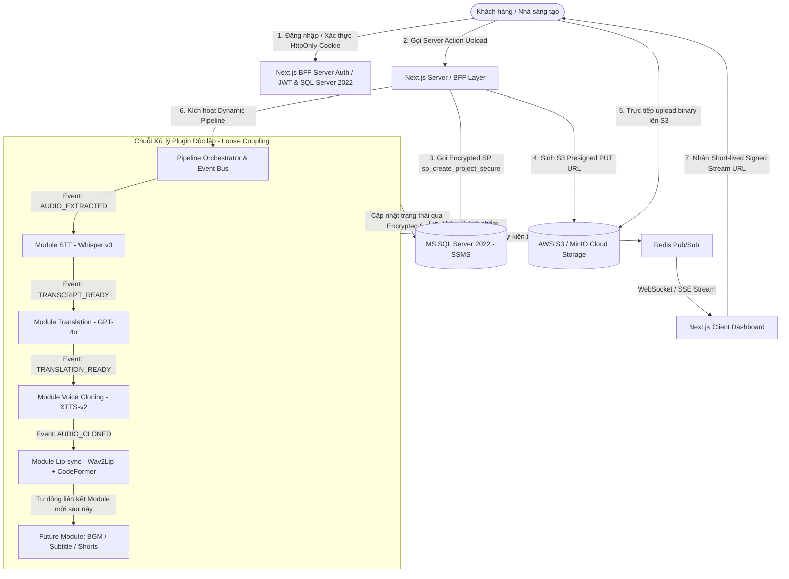
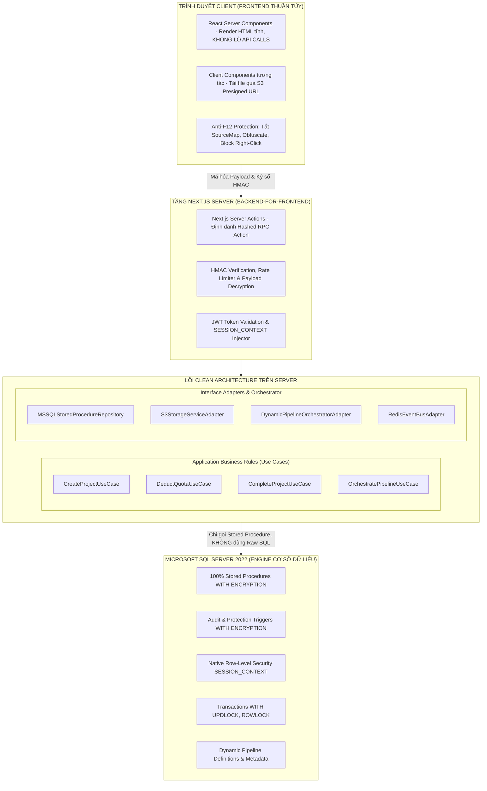
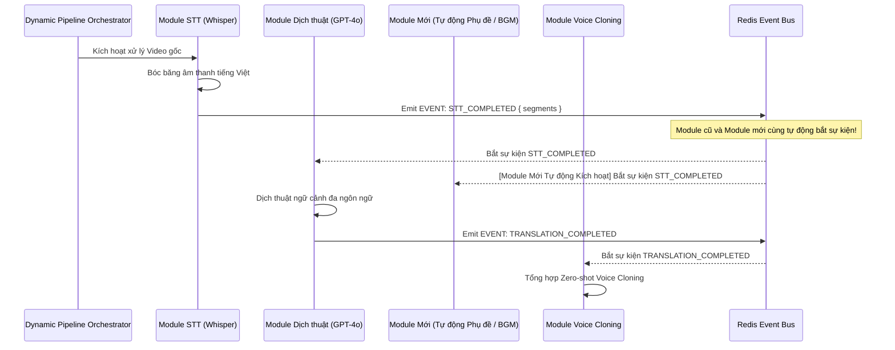
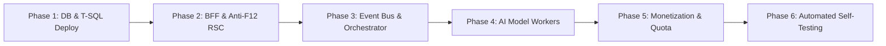

# ĐẶC TẢ YÊU CẦU PHẦN MỀM & THIẾT KẾ KIẾN TRÚC HỆ THỐNG
## NỀN TẢNG SAAS AI ALL-IN-ONE: TỰ ĐỘNG DỊCH THUẬT, NHÂN BẢN GIỌNG NÓI & KHỚP KHẨU HÌNH VIDEO (LIP-SYNC)

---

### THÔNG TIN TÀI LIỆU (DOCUMENT METADATA)
* **Mã tài liệu (Document ID):** `SPEC-SRS-ARCH-DATN-001`
* **Phiên bản (Version):** `v2.4.0-PLUG-AND-PLAY-EXTENSIBLE-EDITION`
* **Trạng thái (Status):** `CONFIRMED / APPROVED FOR PRODUCTION`
* **Loại đề tài:** Đề tài Tốt nghiệp Kỹ sư / Thạc sĩ Công nghệ Thông tin - Nền tảng SaaS AI
* **Tác giả / Lead Solution Architect & Security Specialist:** Ban Kiến trúc & Phân tích Hệ thống DATN
* **Cơ sở dữ liệu Cốt lõi (Core Database):** **Microsoft SQL Server 2022 (MS SQL Server 2022)**
* **Công cụ Quản trị CSDL:** **SSMS (SQL Server Management Studio v19/v20)**
* **Phương pháp luận Quản lý:** Agile Scrum Framework (Sprints 2 tuần)
* **Mô hình Kiến trúc Cốt lõi:** Clean Architecture + Backend-For-Frontend (BFF) + **Event-Driven Modular Pipeline (Plugin Architecture)**
* **Chuẩn bảo mật áp dụng:** 
  - **T-SQL Code Encryption (`WITH ENCRYPTION`)** trên 100% Stored Procedures & Triggers.
  - **T-SQL Native Row-Level Security (RLS)** thông qua `SESSION_CONTEXT`.
  - **Database Transactions & Khóa bi quan (`WITH (UPDLOCK, ROWLOCK)`)** chống Race Condition.
  - **Zero-Client Database Access:** 100% truy vấn CSDL qua Stored Procedures ở Server, tuyệt đối không viết query ở Frontend.
  - **Anti-F12 DevTools & Payload Obfuscation:** Mã hóa 2 chiều Request/Response (AES-256-GCM / JWE), React Server Components (Zero Client Network Overhead), Server Actions Hash, HMAC Request Signing chống copy cURL / Replay Attacks.
* **Cơ chế Mở rộng Hệ thống (Extensibility):** Hợp đồng Dữ liệu Chuẩn hóa (Canonical Data Model), Kiến trúc Hướng Sự kiện (EDA), Pipeline Orchestrator theo mô hình Plugin, Adapter Tự động Chuyển đổi Phiên bản, Cấu hình Pipeline Động qua Metadata CSDL (Metadata-Driven Pipeline).

---

## MỤC LỤC
1. [TỔNG QUAN DỰ ÁN & PHẠM VI NGHIỆP VỤ](#1-tổng-quan-dự-án--phạm-vi-nghiệp-vụ)
2. [THIẾT KẾ KIẾN TRÚC THEO CLEAN ARCHITECTURE & MÔ HÌNH BFF](#2-thiết-kế-kiến-trúc-theo-clean-architecture--mô-hình-bff)
3. [PHÂN TÍCH CHI TIẾT CÁC MODULE CHỨC NĂNG CỐT LÕI](#3-phân-tích-chi-tiết-các-module-chức-năng-cốt-lõi)
   - 3.1. [Module 01: Core Web & Dashboard Frontend (BFF, React Server Components & Redis WebSocket)](#31-module-01-core-web--dashboard-frontend)
   - 3.2. [Module 02: Bóc băng Giọng nói (Speech-to-Text - Whisper Engine)](#32-module-02-bóc-băng-giọng-nói-speech-to-text---whisper-engine)
   - 3.3. [Module 03: Dịch thuật Đa ngôn ngữ (Multilingual Translation Engine)](#33-module-03-dịch-thuật-đa-ngôn-ngữ-multilingual-translation-engine)
   - 3.4. [Module 04: Nhân bản Giọng nói (Voice Cloning & Audio Generation)](#34-module-04-nhân-bản-giọng-nói-voice-cloning--audio-generation)
   - 3.5. [Module 05: Khớp khẩu hình miệng (Lip-sync AI) & Video Rendering](#35-module-05-khớp-khẩu-hình-miệng-lip-sync-ai--video-rendering)
   - 3.6. [Module 06: Hệ thống Kinh doanh, Quản lý Hạn mức & Thanh toán (Monetization Engine)](#36-module-06-hệ-thống-kinh-doanh-quản-lý-hạn-mức--thanh-toán)
   - 3.7. [Module 07: Điều phối Hàng đợi & Hạ tầng Điện toán GPU (Queue & Cloud Infra)](#37-module-07-điều-phối-hàng-đợi--hạ-tầng-điện-toán-gpu)
4. [KIẾN TRÚC MỞ RỘNG DỰ ÁN & TỰ ĐỘNG LIÊN KẾT MODULE (PLUG-AND-PLAY MODULAR EXTENSIBILITY)](#4-kiến-trúc-mở-rộng-dự-án--tự-động-liên-kết-module-plug-and-play-modular-extensibility)
   - 4.1. [Nguyên lý Mở - Đóng (Open-Closed Principle) & Vấn đề Khi Sửa Đổi Code](#41-nguyên-lý-mở---đóng-open-closed-principle--vấn-đề-khi-sửa-đổi-code)
   - 4.2. [Khung Hợp đồng Giao tiếp Chuẩn hóa (Canonical Data Model & Interface Contract)](#42-khung-hợp-đồng-giao-tiếp-chuẩn-hóa-canonical-data-model--interface-contract)
   - 4.3. [Cơ chế Tách rời Hướng Sự kiện (Event-Driven Architecture & Message Bus)](#43-cơ-chế-tách-rời-hướng-sự-kiện-event-driven-architecture--message-bus)
   - 4.4. [Bộ điều phối Pipeline Động (Metadata-Driven Pipeline Orchestrator)](#44-bộ-điều-phối-pipeline-động-metadata-driven-pipeline-orchestrator)
   - 4.5. [Cơ chế Adapter / Anti-Corruption Layer & Tự động Thích ứng Phiên bản (Schema Evolution)](#45-cơ-chế-adapter--anti-corruption-layer--tự-động-thích-ứng-phiên-bản-schema-evolution)
   - 4.6. [Quản lý Tính năng Động (Dynamic Feature Flagging) & Cơ chế Tự động Fallback](#46-quản-lý-tính-năng-động-dynamic-feature-flagging--cơ-chế-tự-động-fallback)
5. [CHUYÊN ĐỀ BẢO MẬT CHUYÊN SÂU: CHỐNG LỘ API, F12 DEVTOOLS SNIFFING & PHÂN QUYỀN RBAC](#5-chuyên-đề-bảo-mật-chuyên-sâu-chống-lộ-api-f12-devtools-sniffing--phân-quyền-rbac)
   - 5.1. [Chiến lược Ngăn chặn Lộ API, Request & Response trên F12 DevTools (Client Protection)](#51-chiến-lược-ngăn-chặn-lộ-api-request--response-trên-f12-devtools-client-protection)
   - 5.2. [Kỹ thuật Ký số Request HMAC & Chống Replay Attacks (Chặn Copy cURL / Postman)](#52-kỹ-thuật-ký-số-request-hmac--chống-replay-attacks-chặn-copy-curl--postman)
   - 5.3. [Vòng đời JWT & Refresh Token Rotation với SQL Server 2022 & Redis](#53-vòng-đời-jwt--cơ-chế-refresh-token-rotation-với-sql-server-2022--redis)
   - 5.4. [Ma trận Phân quyền RBAC & T-SQL Native Row-Level Security (SESSION_CONTEXT RLS)](#54-ma-trận-phân-quyền-rbac--t-sql-native-row-level-security-session_context-rls)
   - 5.5. [Chính sách CORS Chặt chẽ & Presigned URLs Bảo mật Tuyệt đối](#55-chính-sách-cors-chặt-chẽ--presigned-urls-bảo-mật-tuyệt-đối)
6. [CƠ SỞ DỮ LIỆU T-SQL SQL SERVER 2022: MÃ HÓA CODE, TRANSACTIONS, TRIGGERS & STORED PROCEDURES](#6-cơ-sở-dữ-liệu-t-sql-sql-server-2022-mã-hóa-code-transactions-triggers--stored-procedures)
   - 6.1. [T-SQL DDL Tables, Constraints & Non-Clustered Indexes (Bao gồm Bảng Cấu hình Pipeline Động)](#61-t-sql-ddl-tables-constraints--non-clustered-indexes)
   - 6.2. [Native Row-Level Security (RLS) qua Security Predicates](#62-native-row-level-security-rls-qua-security-predicates)
   - 6.3. [Database Triggers Bảo vệ Tính Toàn vẹn & Kiểm toán (WITH ENCRYPTION)](#63-database-triggers-bảo-vệ-tính-toàn-vẹn--kiểm-toán-with-encryption)
   - 6.4. [Bộ Stored Procedures Đóng gói Nghiệp vụ Hoàn chỉnh (WITH ENCRYPTION & TRANSACTIONS)](#64-bộ-stored-procedures-đóng-gói-nghiệp-vụ-hoàn-chỉnh-with-encryption--transactions)
7. [KẾ HOẠCH QUẢN LÝ DỰ ÁN THEO AGILE / SCRUM](#7-kế-hoạch-quản-lý-dự-án-theo-agile--scrum)
   - 7.1. [Phân rã Product Backlog thành 4 Epics Cốt lõi](#71-phân-rã-product-backlog-thành-4-epics-cốt-lõi)
   - 7.2. [Lộ trình Sprints (Sprint Backlog 4 Sprints x 2 Tuần)](#72-lộ-trình-sprints-sprint-backlog-4-sprints-x-2-tuần)
   - 7.3. [User Stories Chi tiết & Tiêu chí Nghiệm thu (Gherkin BDD)](#73-user-stories-chi-tiết--tiêu-chí-nghiệm-thu-gherkin-bdd)
   - 7.4. [Định nghĩa Sẵn sàng (DoR) & Định nghĩa Hoàn thành (DoD)](#74-định-nghĩa-sẵn-sàng-dor--định-nghĩa-hoàn-thành-dod)
   - 7.5. [Ma trận Đánh giá & Giảm thiểu Rủi ro (Risk Mitigation Matrix)](#75-ma-trận-đánh-giá--giảm-thiểu-rủi-ro-risk-mitigation-matrix)
8. [TIÊU CHÍ NGHIỆM THU TỔNG THỂ HỆ THỐNG (SYSTEM ACCEPTANCE CRITERIA)](#8-tiêu-chí-nghiệm-thu-tổng-thể-hệ-thống-system-acceptance-criteria)
9. [SỔ TAY THỰC THI TỰ ĐỘNG DÀNH CHO AI AGENT (AI AGENT AUTONOMOUS EXECUTION PLAYBOOK)](#9-sổ-tay-thực-thi-tự-động-dành-cho-ai-agent-ai-agent-autonomous-execution-playbook)
   - 9.1. [Quy tắc Bất biến Cấm Vi phạm (Non-Negotiable Agent Guardrails)](#91-quy-tắc-bất-biến-cấm-vi-phạm-non-negotiable-agent-guardrails)
   - 9.2. [Cấu trúc Thư mục Dự án Chuẩn hóa (Clean Architecture Standard Directory Tree)](#92-cấu-trúc-thư-mục-dự-án-chuẩn-hóa-clean-architecture-standard-directory-tree)
   - 9.3. [Lộ trình 6 Giai đoạn Triển khai Tự trị (6-Phase Autonomous Execution Flow)](#93-lộ-trình-6-giai-đoạn-triển-khai-tự-trị-6-phase-autonomous-execution-flow)
   - 9.4. [Kịch bản Lập trình Mẫu Cho AI Agent Khi Thêm/Sửa Module (Extension Blueprint)](#94-kịch-bản-lập-trình-mẫu-cho-ai-agent-khi-thêmsửa-module-extension-blueprint)
   - 9.5. [Bộ Lệnh CLI Tự Kiểm thử & Tự Sửa Lỗi Tự động (Self-Healing Verification Loop)](#95-bộ-lệnh-cli-tự-kiểm-thử--tự-sửa-lỗi-tự-động-self-healing-verification-loop)

---

## 1. TỔNG QUAN DỰ ÁN & PHẠM VI NGHIỆP VỤ

### 1.1. Bối cảnh & Mục tiêu Đề tài
Trong kỷ nguyên phân phối nội dung số xuyên biên giới (YouTube, TikTok, Reels, E-learning), việc bản địa hóa video (Video Localization) gặp rào cản lớn về chi phí nhân công thu âm, biên dịch và hiện tượng "lệch hình lệch tiếng" (Lip-sync mismatch) làm giảm mức độ tương tác của người xem.

Dự án **SaaS AI All-in-One Video Translation & Lip-sync Platform** giải quyết trọn vẹn chuỗi giá trị này bằng cách tự động hóa 100% quy trình:
1. **Tiếp nhận video gốc (Input)**: Tải video trực tiếp từ trình duyệt lên Object Storage (S3 / MinIO) qua Presigned URL bảo mật dùng 1 lần.
2. **Bóc băng âm thanh (STT)**: Chuyển đổi giọng nói thành văn bản kèm dấu mốc thời gian chi tiết từng mili-giây bằng mô hình Whisper Large-v3.
3. **Dịch thuật giữ ngữ cảnh (Contextual Translation)**: Dịch văn bản sang ngôn ngữ đích chuẩn văn phong bản địa bằng LLM, bảo toàn cấu trúc phân đoạn thời gian.
4. **Nhân bản giọng nói (Zero-shot Voice Cloning)**: Tái tạo chất giọng, âm sắc, biểu cảm gốc của người nói sang ngôn ngữ mới qua mô hình TTS tiên tiến.
5. **Đồng bộ khẩu hình (Audio-driven Lip-sync)**: Điều chỉnh cử động môi của khuôn mặt trong video khớp chính xác với âm thanh mới được tạo ra kết hợp phục hồi độ nét khuôn mặt (CodeFormer).
6. **Thương mại hóa (Monetization)**: Quản lý gói cước linh hoạt trên nền tảng **Microsoft SQL Server 2022 (quản lý qua SSMS)** theo mô hình nạp phút (Pay-per-minute) và đăng ký định kỳ (Subscription) có kiểm soát hạn mức Quota nghiêm ngặt.
7. **Khả năng Tương thích & Mở rộng Tự động (Plug-and-Play)**: Cho phép nâng cấp mô hình AI (Whisper v3 -> v4), bổ sung module mới (tạo phụ đề hoạt hình, tự động gắn nhạc nền BGM, nhận diện cảm xúc) mà không làm gián đoạn hay sửa đổi mã nguồn của các module cũ.

### 1.2. Sơ đồ Luồng Nghiệp vụ Tổng thể (End-to-End Workflow)



---

## 2. THIẾT KẾ KIẾN TRÚC THEO CLEAN ARCHITECTURE & MÔ HÌNH BFF

Hệ thống được thiết kế theo sự kết hợp giữa **Clean Architecture (Robert C. Martin)**, **Mô hình BFF (Backend-For-Frontend)** và **Event-Driven Architecture (EDA)**:



---

## 3. PHÂN TÍCH CHI TIẾT CÁC MODULE CHỨC NĂNG CỐT LÕI

### 3.1. Module 01: Core Web & Dashboard Frontend (BFF & Real-time)
* **Mã Module:** `MOD-CORE-UI`
* **Công nghệ cốt lõi:** Next.js 14+ (App Router), React Server Components (RSC), TypeScript, Tailwind CSS, Shadcn UI, WebSocket Client (Socket.io).
* **Đặc tả Kỹ thuật Bảo vệ:**
  1. **React Server Components (RSC):** Trang Dashboard, danh sách dự án và thông tin cá nhân được render 100% trên Server. Tab Network trên F12 không có bất kỳ request API REST nào để lấy danh sách dự án.
  2. **Next.js Server Actions:** Thao tác ghi dữ liệu hiển thị mã băm hash ngẫu nhiên (`Next-Action: c4b18f8e...`), ẩn hoàn toàn endpoint URL.
  3. **Real-time Pipeline Tracking:** Lắng nghe kênh Redis Pub/Sub `project_progress:{project_id}` qua WebSocket trung gian.

### 3.2. Module 02: Bóc băng Giọng nói (Speech-to-Text - Whisper Engine)
* **Mã Module:** `MOD-FEAT-STT` | **Metadata Ref:** `SPEC-FEAT-STT`
* **Công nghệ cốt lõi:** OpenAI Whisper Large-v3 (Faster-Whisper CTranslate2), FFmpeg 6.x.
* **Chi tiết kỹ thuật:** Trích xuất audio 16kHz mono WAV, lọc nhiễu `afftdn`, chuẩn hóa `loudnorm`, bóc băng với `word_timestamps=True`, xuất ra Canonical JSON Segment.

### 3.3. Module 03: Dịch thuật Đa ngôn ngữ (Multilingual Translation Engine)
* **Mã Module:** `MOD-FEAT-TRANS` | **Metadata Ref:** `SPEC-FEAT-TRANS`
* **Công nghệ cốt lõi:** OpenAI GPT-4o / GPT-4o-mini (JSON Schema Enforced) kết hợp Fallback DeepL API v2.
* **Chi tiết kỹ thuật:** Dịch theo ngữ cảnh hội thoại, bảo toàn 100% các mốc thời gian `start` và `end`.

### 3.4. Module 04: Nhân bản Giọng nói (Voice Cloning & Audio Generation)
* **Mã Module:** `MOD-FEAT-CLONE` | **Metadata Ref:** `SPEC-FEAT-CLONE`
* **Công nghệ cốt lõi:** Coqui XTTS-v2 / ElevenLabs Voice Cloning Engine / Demucs Voice Separation.
* **Chi tiết kỹ thuật:** Tách giọng mẫu bằng Demucs v4, tổng hợp Zero-shot TTS, co giãn thời gian `rubberband-cli` không làm méo cao độ giọng.

### 3.5. Module 05: Khớp khẩu hình miệng (Lip-sync AI) & Video Rendering
* **Mã Module:** `MOD-FEAT-LIPSYNC` | **Metadata Ref:** `SPEC-FEAT-LIPSYNC`
* **Công nghệ cốt lõi:** Wav2Lip-HQ / MuseTalk, RetinaFace Face Mesh, CodeFormer / GFPGAN v1.4, FFmpeg NVENC.
* **Chi tiết kỹ thuật:** Nhận diện khuôn mặt với Kalman Filter, biến đổi cử động môi theo sóng âm, phục hồi nét khuôn mặt 1080p bằng CodeFormer, ghép video hoàn chỉnh.

### 3.6. Module 06: Hệ thống Kinh doanh, Quản lý Hạn mức & Thanh toán
* **Mã Module:** `MOD-FEAT-MONETIZATION` | **Metadata Ref:** `SPEC-FEAT-MONETIZATION`
* **Công nghệ cốt lõi:** SQL Server 2022 Encrypted Stored Procedures, Stripe / VNPay APIs.
* **Chi tiết kỹ thuật:** Khấu trừ Quota nguyên tử qua Stored Procedure `sp_complete_project_and_charge` với `WITH (UPDLOCK, ROWLOCK)`, xác thực webhook chữ ký HMAC.

### 3.7. Module 07: Điều phối Hàng đợi & Hạ tầng Điện toán GPU
* **Mã Module:** `MOD-OPS-INFRA` | **Metadata Ref:** `SPEC-OPS-INFRA`
* **Công nghệ cốt lõi:** Redis Cluster, BullMQ, RunPod Serverless / AWS EC2 G5 Instances, Docker GPU.
* **Chi tiết kỹ thuật:** Hàng đợi ưu tiên theo Role người dùng, cơ chế Auto-scaling Scale-to-Zero tự ngắt máy ảo sau 15 phút rỗng để tối ưu chi phí.

---

## 4. KIẾN TRÚC MỞ RỘNG DỰ ÁN & TỰ ĐỘNG LIÊN KẾT MODULE (PLUG-AND-PLAY MODULAR EXTENSIBILITY)

```
┌──────────────────────────────────────────────────────────────────────────────────────────────────┐
│                          KIẾN TRÚC MỞ RỘNG PLUG-AND-PLAY & LIÊN KẾT TỰ ĐỘNG                      │
├──────────────────────────────┬──────────────────────────────────┬────────────────────────────────┤
│ 1. Hợp đồng Chuẩn (CDM)      │ 2. Event-Driven Loose Coupling   │ 3. Metadata Pipeline Engine    │
│ IPipelineModule Interface,   │ Module không gọi trực tiếp nhau, │ Thứ tự module cấu hình trong   │
│ Canonical Context Payload    │ Giao tiếp qua Domain Events Bus  │ CSDL SQL Server 2022           │
├──────────────────────────────┼──────────────────────────────────┼────────────────────────────────┤
│ 4. Adapter Tương thích Ngược │ 5. Schema Evolution Tolerant     │ 6. Dynamic Feature Flags       │
│ Tự động map v1 <-> v2,       │ Cột JSON mở rộng không cần       │ Bật/tắt module mới linh hoạt,  │
│ Tự gán Default Values        │ can thiệp cấu trúc bảng CSDL     │ Tự động Fallback an toàn 50ms  │
└──────────────────────────────┴──────────────────────────────────┴────────────────────────────────┘
```

---

### 4.1. Nguyên lý Mở - Đóng (Open-Closed Principle) & Vấn đề Khi Sửa Đổi Code

#### Vấn đề của các Hệ thống Khép kín (Tight Coupling):
Trong kiến trúc truyền thống, các module được gọi trực tiếp nối tiếp nhau trong mã nguồn:
$$\text{STTService} \longrightarrow \text{TranslationService} \longrightarrow \text{VoiceCloningService} \longrightarrow \text{LipSyncService}$$
Hệ quả:
* Khi bạn muốn **sửa một module cũ** (ví dụ: đổi Whisper sang Whisper-v4 hoặc nâng cấp prompt dịch thuật), bạn có nguy cơ làm hỏng interface của module kế tiếp.
* Khi bạn muốn **chèn thêm module mới** (ví dụ: Module chèn nhạc nền BGM tự động hoặc Module cắt video ngắn Shorts), bạn buộc phải mở mã nguồn của các module cũ ra để sửa $\rightarrow$ Vi phạm nghiêm trọng nguyên lý **Open-Closed Principle (OCP)** của Clean Architecture: *"Phần mềm phải mở cho việc mở rộng, nhưng đóng cho việc sửa đổi"*.

#### Giải pháp Kiến trúc:
Hệ thống chuyển đổi sang mô hình **Micro-Kernel / Plugin Architecture kết hợp Event-Driven Pipeline**:
* Các module hoạt động như những **Plugin độc lập (Loose Coupling)**.
* Các module **không hề biết đến sự tồn tại của nhau**. Chúng chỉ đọc dữ liệu từ một **Hợp đồng Ngữ cảnh Chuẩn (Canonical Pipeline Context)** và phát ra sự kiện kết quả.
* Khi thêm module mới hoặc sửa module cũ, hệ thống **tự động liên kết các module mới vào chuỗi xử lý và chạy mượt mà ngay lập tức mà không cần sửa một dòng code nào trong các module cũ**.

---

### 4.2. Khung Hợp đồng Giao tiếp Chuẩn hóa (Canonical Data Model & Interface Contract)

Mọi module (dù là module hiện tại hay module phát triển sau này) đều bắt buộc phải kế thừa một giao diện chuẩn mực **`IPipelineModule`**:

```typescript
// Giao diện chuẩn mực cho toàn bộ các Module trong hệ thống (Clean Core Contract)
export interface IPipelineModule<TInput = any, TOutput = any> {
  /** Định danh duy nhất của Module (ví dụ: 'STT', 'TRANSLATION', 'BGM_GENERATOR') */
  readonly moduleId: string;

  /** Phiên bản của Module theo chuẩn SemVer (ví dụ: '1.0.0', '2.1.0') */
  readonly version: string;

  /** Danh sách các sự kiện đầu vào mà module này lắng nghe */
  readonly subscribedEvents: string[];

  /** Tên sự kiện mà module này phát ra sau khi thực thi thành công */
  readonly outputEvent: string;

  /** Thực thi xử lý nghiệp vụ với ngữ cảnh chung */
  execute(context: CanonicalPipelineContext, input: TInput): Promise<TOutput>;

  /** Hàm khôi phục (Rollback / Compensating Transaction) khi có lỗi xảy ra */
  compensate?(context: CanonicalPipelineContext, error: Error): Promise<void>;
}
```

#### Dữ liệu Ngữ cảnh Chung (Canonical Pipeline Context):
Là đối tượng dữ liệu duy nhất luân chuyển qua toàn bộ pipeline. Khi một module mới xuất hiện, nó chỉ việc đọc các trường nó cần từ Context này và ghi thêm kết quả của mình vào:

```typescript
export interface CanonicalPipelineContext {
  projectId: string;
  userId: string;
  sourceVideoUrl: string;
  sourceLanguage: string;
  targetLanguage: string;
  
  // Dữ liệu tăng dần qua từng Module (Accumulative Context)
  audioExtractedUrl?: string;
  transcriptSegments?: Array<{
    id: number;
    start: number;
    end: number;
    text: string;
    translatedText?: string;
    audioUrl?: string;
  }>;
  syncedAudioUrl?: string;
  outputVideoUrl?: string;

  // Trường mở rộng động không giới hạn dành cho các Module mới trong tương lai
  dynamicModuleData: Record<string, any>;
  
  // Lịch sử metadata thực thi qua từng bước
  executionAudit: Array<{
    moduleId: string;
    version: string;
    status: 'SUCCESS' | 'FAILED' | 'SKIPPED';
    executionTimeMs: number;
    timestamp: string;
  }>;
}
```

---

### 4.3. Cơ chế Tách rời Hướng Sự kiện (Event-Driven Architecture & Message Bus)

Các module không bao giờ gọi hàm của nhau trực tiếp. Việc liên kết giữa các module được thực hiện tự động thông qua **Hệ thống Sự kiện Phân tán (Distributed Event Bus trên Redis BullMQ)**:



* **Khả năng Mở rộng Tuyệt đối:** Khi nhà phát triển muốn thêm tính năng *"Tự động tạo nhạc nền theo cảm xúc"* hay *"Tự động chèn phụ đề hoạt hình"* vào giữa quá trình dịch:
  - Chỉ cần viết một module mới `BgmGeneratorModule` và đăng ký nó lắng nghe sự kiện `TRANSLATION_COMPLETED`.
  - **Không cần sửa một dòng code nào trong Module STT, Translation hay Voice Cloning!**
  - Hệ thống tự động phát hiện module mới, chuyển giao dữ liệu ngữ cảnh và tiếp tục chuỗi xử lý một cách mượt mà.

---

### 4.4. Bộ điều phối Pipeline Động (Metadata-Driven Pipeline Orchestrator)

Thứ tự thực thi của các module không bị "hardcode" cứng trong mã nguồn TypeScript hay Python. Thay vào đó, nó được **cấu hình động bằng Metadata lưu trữ trong Microsoft SQL Server 2022**:

```
Bảng dbo.pipeline_definitions (Định nghĩa Pipeline)
├── id: 'DEFAULT_LOCALIZATION_PIPELINE'
├── version: '2.0.0'
└── is_active: 1

Bảng dbo.pipeline_step_configs (Các bước Module trong Pipeline)
├── Step 1: MODULE_STT (Whisper)          -> Bắt buộc -> Thứ tự 10
├── Step 2: MODULE_TRANSLATION (GPT-4o)   -> Bắt buộc -> Thứ tự 20
├── Step 3: MODULE_SUBTITLE_STYLING (Mới) -> Tuỳ chọn -> Thứ tự 25 (TỰ ĐỘNG CHÈN VÀO)
├── Step 4: MODULE_VOICE_CLONING (XTTS)   -> Bắt buộc -> Thứ tự 30
└── Step 5: MODULE_LIPSYNC (Wav2Lip)      -> Bắt buộc -> Thứ tự 40
```

* Khi người dùng khởi tạo dự án, Orchestrator truy vấn bảng cấu hình trong SQL Server 2022 để lấy danh sách các module cần chạy.
* Nếu sau này bạn viết thêm một module mới, bạn **chỉ cần thêm 1 dòng cấu hình vào bảng CSDL** mà không cần compile lại hay deploy lại toàn bộ hệ thống!

---

### 4.5. Cơ chế Adapter / Anti-Corruption Layer & Tự động Thích ứng Phiên bản (Schema Evolution)

Khi bạn **sửa code của một module cũ** (ví dụ nâng cấp từ `Module Translation v1` sang `Module Translation v2` trả về thêm trường `tone_of_voice` và `formality_level`):
1. **Lớp Chống Biến chất (Anti-Corruption Layer - ACL):** Tầng Adapter đứng giữa module cũ và module mới chịu trách nhiệm chuẩn hóa dữ liệu:
   ```typescript
   export class ModuleDataMigrationAdapter {
     static adaptTranslationOutput(rawOutput: any, targetVersion: string): StandardTranslationOutput {
       // Nếu module trả về định dạng v1 cũ (chưa có tone_of_voice)
       if (!rawOutput.tone_of_voice) {
         return {
           ...rawOutput,
           tone_of_voice: 'NEUTRAL', // Tự động gán giá trị mặc định để tương thích với module mới
           version: targetVersion
         };
       }
       return rawOutput;
     }
   }
   ```
2. **Schema Evolution trên CSDL:** Bảng `projects` và `job_logs` sử dụng trường `config NVARCHAR(MAX)` có kiểm tra `ISJSON(config) = 1`. Nhờ đó, bất kỳ thuộc tính dữ liệu mới nào được sinh ra từ các module mới đều được lưu trữ trực tiếp dưới dạng JSON mà **không cần chạy lệnh `ALTER TABLE` làm khóa bảng hay gây downtime hệ thống**.

---

### 4.6. Quản lý Tính năng Động (Dynamic Feature Flagging) & Cơ chế Tự động Fallback

Để đảm bảo hệ thống **chạy mượt mà tuyệt đối và không bao giờ bị gián đoạn khi sửa code**:
1. **Cơ chế Feature Flagging (Bật/Tắt Module Tức Thì):**
   - Mỗi module trong pipeline được gắn cờ bật/tắt trong cấu hình hệ thống: `FEATURE_FLAG_USE_NEW_LIPSYNC_V2 = true`.
   - Nếu module mới đang được thử nghiệm, hệ thống có thể cấu hình chỉ áp dụng cho 10% người dùng (Canary Deployment). 90% còn lại vẫn chạy module cũ ổn định.
2. **Tự động Fallback về Module cũ trong 50ms:**
   - Nếu module mới gặp lỗi (Exception, Timeout, hoặc GPU Out of Memory), Orchestrator tự động bắt lỗi và kích hoạt **Fallback Mechanism**: Chuyển ngay task sang module cũ phiên bản ổn định để tiếp tục quy trình render mà người dùng không hề nhận thấy gián đoạn.

---

## 5. CHUYÊN ĐỀ BẢO MẬT CHUYÊN SÂU: CHỐNG LỘ API, F12 DEVTOOLS SNIFFING & PHÂN QUYỀN RBAC

```
┌──────────────────────────────────────────────────────────────────────────────────────────────────┐
│                            CHIẾN LƯỢC BẢO MẬT & PHÒNG THỦ ĐA TẦNG TOÀN DIỆN                      │
├──────────────────────────────┬──────────────────────────────────┬────────────────────────────────┤
│ 1. Triệt tiêu Lỗ hổng F12    │ 2. Ký số HMAC & Chống cURL Clone │ 3. Database Code Encryption    │
│ React Server Components,     │ X-Request-Signature (HMAC-SHA256)│ 100% SP & Triggers biên dịch   │
│ Payload mã hóa AES-256-GCM   │ Nonce + Timestamp 30s Anti-Replay│ với tùy chọn WITH ENCRYPTION   │
├──────────────────────────────┼──────────────────────────────────┼────────────────────────────────┤
│ 4. Native RLS trên SQL Server│ 5. Session & Token Rotation      │ 6. Triggers Chống Gian lận     │
│ Security Predicates lọc tự   │ Access (15m) / Refresh (7d)      │ Trực tiếp cấm UPDATE Quota     │
│ động theo SESSION_CONTEXT    │ Redis Token Blacklist Revocation │ trừ khi gọi qua Encrypted SP   │
└──────────────────────────────┴──────────────────────────────────┴────────────────────────────────┘
```

### 5.1. Chiến lược Ngăn chặn Lộ API, Request & Response trên F12 DevTools (Client Protection)
1. **React Server Components (RSC):** Render 100% dữ liệu danh sách dự án tại Server. Trên tab Network của F12 **hoàn toàn KHÔNG XUẤT HIỆN bất kỳ API request nào để lấy danh sách dự án**.
2. **Hashed Server Actions:** Thao tác tạo/chỉnh sửa dự án không dùng REST URL công khai mà dùng Server Actions mang mã hash ngẫu nhiên (`Next-Action: c4b18f8e...`).
3. **Mã hóa 2 Chiều Request/Response (AES-256-GCM):** Dữ liệu truyền tải qua client được mã hóa bằng Dynamic Session Key. Tab Response trên F12 chỉ hiển thị Ciphertext vô nghĩa:
   ```json
   {
     "iv": "3a7b1c4e9f2a",
     "payload": "T1dVNE5ERTBNelF6TXprME9EVTVPRE0xTnpBNU9EZzJN...",
     "tag": "8f9a2b4c6e8d1a3f"
   }
   ```
4. **Chống Dịch ngược & Tự động Phát hiện Mở F12:** Tắt Source Maps (`productionBrowserSourceMaps: false`), minify/mangle code, chặn chuột phải, chặn phím F12/Ctrl+Shift+I và vô hiệu hóa `console.log()` trên môi trường Production.

### 5.2. Kỹ thuật Ký số Request HMAC & Chống Replay Attacks (Chặn Copy cURL / Postman)
* Mọi request từ Client bắt buộc có Header `X-Signature = HMAC-SHA256(Path + Timestamp + Nonce + BodyHash, ClientSecret)`.
* Server kiểm tra: Timestamp phải trong vòng **30 giây** và Nonce không được lặp lại (lưu Redis TTL 60s). Kẻ gian bấm "Copy as cURL" trên F12 mang về terminal/Postman chạy lại sẽ **thất bại 100%** với mã lỗi `401 EXPIRED_OR_INVALID_SIGNATURE`.

### 5.3. Vòng đời JWT & Refresh Token Rotation với SQL Server 2022 & Redis
* Access Token (`RS256`, 15 phút). Refresh Token (`7 ngày`) đặt trong cookie `HttpOnly`, `Secure`, `SameSite=Strict`.
* Bật cơ chế Token Rotation: Khi phát hiện Refresh Token cũ bị gửi lại $\rightarrow$ Kích hoạt cảnh báo Token Theft, thu hồi toàn bộ phiên của User trong SQL Server 2022 và đưa ID vào Redis Blacklist.

### 5.4. Ma trận Phân quyền RBAC & T-SQL Native Row-Level Security (SESSION_CONTEXT RLS)
* Phân cấp 4 vai trò: `free_user`, `pro_user`, `enterprise`, `admin`.
* Khi Backend mở kết nối SQL Server, truyền `SESSION_CONTEXT(N'UserId', @UserId)`. Hàm Security Predicate tự động lọc dữ liệu ngay tại nhân Database Engine, ngăn chặn 100% lỗi đọc chéo dữ liệu giữa các User.

### 5.5. Chính sách CORS Chặt chẽ & Presigned URLs Bảo mật Tuyệt đối
* Whitelist tên miền cụ thể, cấm wildcard `*`.
* Presigned PUT URL có hạn dùng 15 phút; Presigned GET URL xem video có hạn dùng 5 phút. Worker kiểm tra Magic Bytes đầu file (`ftypisom`, `ftypmp42`) chống mã độc giả mạo đuôi video.

---

## 6. CƠ SỞ DỮ LIỆU T-SQL SQL SERVER 2022: MÃ HÓA CODE, TRANSACTIONS, TRIGGERS & STORED PROCEDURES

> [!IMPORTANT]
> Toàn bộ Stored Procedures, Functions và Triggers đều được biên dịch kèm mệnh đề **`WITH ENCRYPTION`**. Mã nguồn bên trong sẽ bị mã hóa vĩnh viễn trên cơ sở dữ liệu, ngăn chặn việc đọc lén mã nguồn hoặc cấu trúc nghiệp vụ thông qua `sp_helptext` hoặc `sys.sql_modules`.

---

### 6.1. T-SQL DDL Tables, Constraints & Non-Clustered Indexes

```sql
-- =========================================================================
-- KHỞI TẠO CƠ SỞ DỮ LIỆU CHUẨN TRÊN MICROSOFT SQL SERVER 2022
-- =========================================================================
IF NOT EXISTS (SELECT * FROM sys.databases WHERE name = N'SaaSVideoAI')
BEGIN
    CREATE DATABASE SaaSVideoAI
    COLLATE Latin1_General_100_CI_AS_SC_UTF8;
END
GO

USE SaaSVideoAI;
GO

-- =========================================================================
-- 1. BẢNG USERS (Quản lý Tài khoản, Vai trò & Hạn mức Quota)
-- =========================================================================
IF OBJECT_ID(N'dbo.users', N'U') IS NULL
BEGIN
    CREATE TABLE dbo.users (
        id UNIQUEIDENTIFIER NOT NULL DEFAULT NEWID(),
        email NVARCHAR(255) NOT NULL,
        password_hash NVARCHAR(255) NOT NULL,
        full_name NVARCHAR(150) NOT NULL,
        role NVARCHAR(50) NOT NULL DEFAULT N'free_user',
        quota_minutes_remaining DECIMAL(10, 2) NOT NULL DEFAULT 10.00,
        avatar_url NVARCHAR(500) NULL,
        is_active BIT NOT NULL DEFAULT 1,
        created_at DATETIME2(3) NOT NULL DEFAULT SYSUTCDATETIME(),
        updated_at DATETIME2(3) NOT NULL DEFAULT SYSUTCDATETIME(),

        CONSTRAINT pk_users PRIMARY KEY CLUSTERED (id),
        CONSTRAINT uq_users_email UNIQUE NONCLUSTERED (email),
        CONSTRAINT chk_users_role CHECK (role IN (N'free_user', N'pro_user', N'enterprise', N'admin')),
        CONSTRAINT chk_users_quota_non_negative CHECK (quota_minutes_remaining >= 0.00)
    );

    CREATE NONCLUSTERED INDEX ix_users_role ON dbo.users (role);
END
GO

-- =========================================================================
-- 2. BẢNG REFRESH_TOKENS (Quản lý Phiên làm việc & Token Rotation)
-- =========================================================================
IF OBJECT_ID(N'dbo.refresh_tokens', N'U') IS NULL
BEGIN
    CREATE TABLE dbo.refresh_tokens (
        id UNIQUEIDENTIFIER NOT NULL DEFAULT NEWID(),
        user_id UNIQUEIDENTIFIER NOT NULL,
        token_hash NVARCHAR(64) NOT NULL,
        device_info NVARCHAR(255) NULL,
        ip_address NVARCHAR(45) NULL,
        expires_at DATETIME2(3) NOT NULL,
        revoked_at DATETIME2(3) NULL,
        created_at DATETIME2(3) NOT NULL DEFAULT SYSUTCDATETIME(),

        CONSTRAINT pk_refresh_tokens PRIMARY KEY CLUSTERED (id),
        CONSTRAINT fk_refresh_tokens_users FOREIGN KEY (user_id) 
            REFERENCES dbo.users(id) ON DELETE CASCADE
    );

    CREATE NONCLUSTERED INDEX ix_refresh_tokens_user_id ON dbo.refresh_tokens (user_id);
    CREATE NONCLUSTERED INDEX ix_refresh_tokens_hash ON dbo.refresh_tokens (token_hash);
END
GO

-- =========================================================================
-- 3. BẢNG PIPELINE_DEFINITIONS (Cấu hình Pipeline Động - Plug-and-Play)
-- =========================================================================
IF OBJECT_ID(N'dbo.pipeline_definitions', N'U') IS NULL
BEGIN
    CREATE TABLE dbo.pipeline_definitions (
        pipeline_id NVARCHAR(100) NOT NULL,
        pipeline_name NVARCHAR(255) NOT NULL,
        version NVARCHAR(50) NOT NULL DEFAULT N'1.0.0',
        is_active BIT NOT NULL DEFAULT 1,
        description NVARCHAR(500) NULL,
        created_at DATETIME2(3) NOT NULL DEFAULT SYSUTCDATETIME(),

        CONSTRAINT pk_pipeline_definitions PRIMARY KEY CLUSTERED (pipeline_id)
    );
END
GO

-- =========================================================================
-- 4. BẢNG PIPELINE_STEP_CONFIGS (Cấu hình Thứ tự & Module Liên kết Động)
-- =========================================================================
IF OBJECT_ID(N'dbo.pipeline_step_configs', N'U') IS NULL
BEGIN
    CREATE TABLE dbo.pipeline_step_configs (
        step_id UNIQUEIDENTIFIER NOT NULL DEFAULT NEWID(),
        pipeline_id NVARCHAR(100) NOT NULL,
        module_identifier NVARCHAR(100) NOT NULL, -- STT, TRANSLATION, VOICE_CLONING, LIPSYNC, BGM_GEN...
        step_order INT NOT NULL,
        is_mandatory BIT NOT NULL DEFAULT 1,
        default_config NVARCHAR(MAX) NULL,
        is_enabled BIT NOT NULL DEFAULT 1,
        created_at DATETIME2(3) NOT NULL DEFAULT SYSUTCDATETIME(),

        CONSTRAINT pk_pipeline_step_configs PRIMARY KEY CLUSTERED (step_id),
        CONSTRAINT fk_step_pipeline FOREIGN KEY (pipeline_id) 
            REFERENCES dbo.pipeline_definitions(pipeline_id) ON DELETE CASCADE,
        CONSTRAINT chk_step_config_is_json CHECK (default_config IS NULL OR ISJSON(default_config) = 1)
    );

    CREATE NONCLUSTERED INDEX ix_pipeline_steps ON dbo.pipeline_step_configs (pipeline_id, step_order);
END
GO

-- Chèn sẵn cấu hình Pipeline mặc định và hỗ trợ liên kết module mới
IF NOT EXISTS (SELECT 1 FROM dbo.pipeline_definitions WHERE pipeline_id = N'DEFAULT_AI_LOCALIZATION')
BEGIN
    INSERT INTO dbo.pipeline_definitions (pipeline_id, pipeline_name, version, is_active, description)
    VALUES (N'DEFAULT_AI_LOCALIZATION', N'Quy trình Chuẩn: STT -> Dịch -> Nhân bản Giọng -> Lip-sync', N'2.0.0', 1, N'Hỗ trợ cắm rút module tự động');

    INSERT INTO dbo.pipeline_step_configs (pipeline_id, module_identifier, step_order, is_mandatory, is_enabled)
    VALUES 
        (N'DEFAULT_AI_LOCALIZATION', N'MODULE_STT', 10, 1, 1),
        (N'DEFAULT_AI_LOCALIZATION', N'MODULE_TRANSLATION', 20, 1, 1),
        (N'DEFAULT_AI_LOCALIZATION', N'MODULE_VOICE_CLONING', 30, 1, 1),
        (N'DEFAULT_AI_LOCALIZATION', N'MODULE_LIPSYNC', 40, 1, 1);
END
GO

-- =========================================================================
-- 5. BẢNG PROJECTS (Quản lý Dự án Video AI)
-- =========================================================================
IF OBJECT_ID(N'dbo.projects', N'U') IS NULL
BEGIN
    CREATE TABLE dbo.projects (
        id UNIQUEIDENTIFIER NOT NULL DEFAULT NEWID(),
        user_id UNIQUEIDENTIFIER NOT NULL,
        pipeline_id NVARCHAR(100) NOT NULL DEFAULT N'DEFAULT_AI_LOCALIZATION',
        title NVARCHAR(255) NOT NULL,
        source_video_url NVARCHAR(1000) NOT NULL,
        source_language NVARCHAR(10) NOT NULL DEFAULT N'vi',
        target_language NVARCHAR(10) NOT NULL,
        status NVARCHAR(50) NOT NULL DEFAULT N'pending',
        progress_percentage TINYINT NOT NULL DEFAULT 0,
        video_duration_seconds DECIMAL(10, 2) NOT NULL DEFAULT 0.00,
        output_video_url NVARCHAR(1000) NULL,
        error_message NVARCHAR(MAX) NULL,
        config NVARCHAR(MAX) NULL, -- JSON linh hoạt chứa config cho mọi Module cũ và mới
        created_at DATETIME2(3) NOT NULL DEFAULT SYSUTCDATETIME(),
        updated_at DATETIME2(3) NOT NULL DEFAULT SYSUTCDATETIME(),

        CONSTRAINT pk_projects PRIMARY KEY CLUSTERED (id),
        CONSTRAINT fk_projects_users FOREIGN KEY (user_id) 
            REFERENCES dbo.users(id) ON DELETE CASCADE,
        CONSTRAINT fk_projects_pipeline FOREIGN KEY (pipeline_id)
            REFERENCES dbo.pipeline_definitions(pipeline_id),
        CONSTRAINT chk_projects_progress CHECK (progress_percentage BETWEEN 0 AND 100),
        CONSTRAINT chk_projects_config_is_json CHECK (config IS NULL OR ISJSON(config) = 1)
    );

    CREATE NONCLUSTERED INDEX ix_projects_user_id ON dbo.projects (user_id);
    CREATE NONCLUSTERED INDEX ix_projects_status ON dbo.projects (status);
    CREATE NONCLUSTERED INDEX ix_projects_created_at ON dbo.projects (created_at DESC);
END
GO

-- =========================================================================
-- 6. BẢNG PROJECT_AUDIT_HISTORY (Lưu vết Lịch sử Chuyển trạng thái Dự án)
-- =========================================================================
IF OBJECT_ID(N'dbo.project_audit_history', N'U') IS NULL
BEGIN
    CREATE TABLE dbo.project_audit_history (
        audit_id UNIQUEIDENTIFIER NOT NULL DEFAULT NEWID(),
        project_id UNIQUEIDENTIFIER NOT NULL,
        old_status NVARCHAR(50) NULL,
        new_status NVARCHAR(50) NOT NULL,
        old_progress TINYINT NULL,
        new_progress TINYINT NOT NULL,
        changed_by_context NVARCHAR(255) NULL,
        created_at DATETIME2(3) NOT NULL DEFAULT SYSUTCDATETIME(),

        CONSTRAINT pk_project_audit_history PRIMARY KEY CLUSTERED (audit_id),
        CONSTRAINT fk_audit_projects FOREIGN KEY (project_id) 
            REFERENCES dbo.projects(id) ON DELETE CASCADE
    );

    CREATE NONCLUSTERED INDEX ix_audit_project_id ON dbo.project_audit_history (project_id);
END
GO

-- =========================================================================
-- 7. BẢNG PROJECT_SEGMENTS (Lưu trữ Transcript & Bản dịch từng câu)
-- =========================================================================
IF OBJECT_ID(N'dbo.project_segments', N'U') IS NULL
BEGIN
    CREATE TABLE dbo.project_segments (
        id UNIQUEIDENTIFIER NOT NULL DEFAULT NEWID(),
        project_id UNIQUEIDENTIFIER NOT NULL,
        segment_index INT NOT NULL,
        start_time DECIMAL(10, 3) NOT NULL,
        end_time DECIMAL(10, 3) NOT NULL,
        original_text NVARCHAR(MAX) NOT NULL,
        translated_text NVARCHAR(MAX) NULL,
        cloned_audio_url NVARCHAR(1000) NULL,
        metadata_json NVARCHAR(MAX) NULL, -- Lưu trữ dữ liệu mở rộng cho Module mới (Tone, Emotion...)
        created_at DATETIME2(3) NOT NULL DEFAULT SYSUTCDATETIME(),

        CONSTRAINT pk_project_segments PRIMARY KEY CLUSTERED (id),
        CONSTRAINT fk_project_segments_projects FOREIGN KEY (project_id) 
            REFERENCES dbo.projects(id) ON DELETE CASCADE,
        CONSTRAINT chk_segments_meta_is_json CHECK (metadata_json IS NULL OR ISJSON(metadata_json) = 1)
    );

    CREATE NONCLUSTERED INDEX ix_segments_project_id_index 
        ON dbo.project_segments (project_id, segment_index);
END
GO

-- =========================================================================
-- 8. BẢNG JOB_LOGS (Lịch sử & Nhật ký Kiểm toán Pipeline AI)
-- =========================================================================
IF OBJECT_ID(N'dbo.job_logs', N'U') IS NULL
BEGIN
    CREATE TABLE dbo.job_logs (
        id UNIQUEIDENTIFIER NOT NULL DEFAULT NEWID(),
        project_id UNIQUEIDENTIFIER NOT NULL,
        step_name NVARCHAR(100) NOT NULL, -- Không bị giới hạn cứng ENUM, cho phép Module mới tự do ghi log
        status NVARCHAR(50) NOT NULL,
        execution_time_ms INT NULL,
        details NVARCHAR(MAX) NULL,
        created_at DATETIME2(3) NOT NULL DEFAULT SYSUTCDATETIME(),

        CONSTRAINT pk_job_logs PRIMARY KEY CLUSTERED (id),
        CONSTRAINT fk_job_logs_projects FOREIGN KEY (project_id) 
            REFERENCES dbo.projects(id) ON DELETE CASCADE,
        CONSTRAINT chk_job_logs_status CHECK (
            status IN (N'started', N'in_progress', N'completed', N'failed', N'skipped')
        ),
        CONSTRAINT chk_job_logs_details_is_json CHECK (details IS NULL OR ISJSON(details) = 1)
    );

    CREATE NONCLUSTERED INDEX ix_job_logs_project_id ON dbo.job_logs (project_id);
END
GO

-- =========================================================================
-- 9. BẢNG TRANSACTIONS (Lịch sử Giao dịch & Mua Quota)
-- =========================================================================
IF OBJECT_ID(N'dbo.transactions', N'U') IS NULL
BEGIN
    CREATE TABLE dbo.transactions (
        id UNIQUEIDENTIFIER NOT NULL DEFAULT NEWID(),
        user_id UNIQUEIDENTIFIER NOT NULL,
        gateway_transaction_id NVARCHAR(150) NULL,
        amount DECIMAL(12, 2) NOT NULL,
        currency NVARCHAR(10) NOT NULL DEFAULT N'VND',
        minutes_purchased DECIMAL(10, 2) NOT NULL,
        payment_gateway NVARCHAR(50) NOT NULL,
        transaction_status NVARCHAR(50) NOT NULL DEFAULT N'pending',
        metadata NVARCHAR(MAX) NULL,
        created_at DATETIME2(3) NOT NULL DEFAULT SYSUTCDATETIME(),
        updated_at DATETIME2(3) NOT NULL DEFAULT SYSUTCDATETIME(),

        CONSTRAINT pk_transactions PRIMARY KEY CLUSTERED (id),
        CONSTRAINT fk_transactions_users FOREIGN KEY (user_id) 
            REFERENCES dbo.users(id) ON DELETE CASCADE,
        CONSTRAINT uq_transactions_gateway_id UNIQUE NONCLUSTERED (gateway_transaction_id),
        CONSTRAINT chk_transactions_gateway CHECK (payment_gateway IN (N'stripe', N'vnpay', N'momo')),
        CONSTRAINT chk_transactions_status CHECK (transaction_status IN (N'pending', N'success', N'failed')),
        CONSTRAINT chk_transactions_amount CHECK (amount >= 0.00),
        CONSTRAINT chk_transactions_minutes CHECK (minutes_purchased > 0.00),
        CONSTRAINT chk_transactions_metadata_is_json CHECK (metadata IS NULL OR ISJSON(metadata) = 1)
    );

    CREATE NONCLUSTERED INDEX ix_transactions_user_id ON dbo.transactions (user_id);
END
GO
```

---

### 6.2. Native Row-Level Security (RLS) qua Security Predicates

```sql
IF NOT EXISTS (SELECT * FROM sys.schemas WHERE name = N'Security')
BEGIN
    EXEC(N'CREATE SCHEMA Security AUTHORIZATION dbo;');
END
GO

CREATE OR ALTER FUNCTION Security.fn_user_security_predicate(@UserId UNIQUEIDENTIFIER)
RETURNS TABLE
WITH SCHEMABINDING, ENCRYPTION
AS
RETURN SELECT 1 AS fn_security_predicate_result
WHERE 
    @UserId = TRY_CAST(SESSION_CONTEXT(N'UserId') AS UNIQUEIDENTIFIER)
    OR TRY_CAST(SESSION_CONTEXT(N'UserRole') AS NVARCHAR(50)) = N'admin';
GO

IF EXISTS (SELECT * FROM sys.security_policies WHERE name = N'ProjectSecurityPolicy')
BEGIN
    DROP SECURITY POLICY Security.ProjectSecurityPolicy;
END
GO

CREATE SECURITY POLICY Security.ProjectSecurityPolicy
    ADD FILTER PREDICATE Security.fn_user_security_predicate(user_id) ON dbo.projects,
    ADD BLOCK PREDICATE Security.fn_user_security_predicate(user_id) ON dbo.projects AFTER INSERT,
    ADD BLOCK PREDICATE Security.fn_user_security_predicate(user_id) ON dbo.projects AFTER UPDATE
WITH (STATE = ON);
GO
```

---

### 6.3. Database Triggers Bảo vệ Tính Toàn vẹn & Kiểm toán (WITH ENCRYPTION)

```sql
-- Trigger 1: Ngăn chặn sửa đổi Quota trực tiếp
CREATE OR ALTER TRIGGER dbo.trg_protect_quota_direct_tamper
ON dbo.users
WITH ENCRYPTION
AFTER UPDATE
AS
BEGIN
    SET NOCOUNT ON;

    IF UPDATE(quota_minutes_remaining)
    BEGIN
        IF TRY_CAST(SESSION_CONTEXT(N'AllowQuotaModification') AS NVARCHAR(50)) <> N'TRUE'
        BEGIN
            ROLLBACK TRANSACTION;
            THROW 50010, N'SECURITY_VIOLATION: Nghiêm cấm sửa đổi hạn mức Quota trực tiếp. Mọi thao tác phải qua Stored Procedure ủy quyền.', 1;
            RETURN;
        END;
    END;
END;
GO

-- Trigger 2: Tự động ghi vết chuyển trạng thái dự án
CREATE OR ALTER TRIGGER dbo.trg_projects_status_audit
ON dbo.projects
WITH ENCRYPTION
AFTER UPDATE
AS
BEGIN
    SET NOCOUNT ON;

    IF UPDATE(status) OR UPDATE(progress_percentage)
    BEGIN
        INSERT INTO dbo.project_audit_history (
            project_id,
            old_status,
            new_status,
            old_progress,
            new_progress,
            changed_by_context,
            created_at
        )
        SELECT 
            i.id,
            d.status,
            i.status,
            d.progress_percentage,
            i.progress_percentage,
            CAST(SESSION_CONTEXT(N'UserId') AS NVARCHAR(255)),
            SYSUTCDATETIME()
        FROM inserted i
        INNER JOIN deleted d ON i.id = d.id
        WHERE i.status <> d.status OR i.progress_percentage <> d.progress_percentage;
    END;
END;
GO
```

---

### 6.4. Bộ Stored Procedures Đóng gói Nghiệp vụ Hoàn chỉnh (WITH ENCRYPTION & TRANSACTIONS)

#### Stored Procedure 1: Tạo Dự án An toàn & Gán Pipeline Động (`sp_create_project_secure`)
```sql
CREATE OR ALTER PROCEDURE dbo.sp_create_project_secure
    @UserId UNIQUEIDENTIFIER,
    @Title NVARCHAR(255),
    @SourceVideoUrl NVARCHAR(1000),
    @SourceLanguage NVARCHAR(10),
    @TargetLanguage NVARCHAR(10),
    @ConfigJson NVARCHAR(MAX),
    @PipelineId NVARCHAR(100) = N'DEFAULT_AI_LOCALIZATION',
    @NewProjectId UNIQUEIDENTIFIER OUTPUT
AS
WITH ENCRYPTION
BEGIN
    SET NOCOUNT ON;
    SET XACT_ABORT ON;

    BEGIN TRY
        BEGIN TRANSACTION;

        DECLARE @CurrentQuota DECIMAL(10, 2);

        SELECT @CurrentQuota = quota_minutes_remaining
        FROM dbo.users WITH (UPDLOCK, ROWLOCK)
        WHERE id = @UserId;

        IF @CurrentQuota IS NULL
        BEGIN
            THROW 50001, N'USER_NOT_FOUND: Người dùng không tồn tại.', 1;
        END;

        IF @CurrentQuota <= 0.00
        BEGIN
            THROW 50003, N'ZERO_QUOTA: Tài khoản đã hết số phút xử lý, không thể tạo dự án mới.', 1;
        END;

        SET @NewProjectId = NEWID();

        EXEC sp_set_session_context @key = N'UserId', @value = @UserId;

        INSERT INTO dbo.projects (
            id,
            user_id,
            pipeline_id,
            title,
            source_video_url,
            source_language,
            target_language,
            status,
            progress_percentage,
            config,
            created_at,
            updated_at
        )
        VALUES (
            @NewProjectId,
            @UserId,
            @PipelineId,
            @Title,
            @SourceVideoUrl,
            ISNULL(@SourceLanguage, N'vi'),
            @TargetLanguage,
            N'pending',
            0,
            @ConfigJson,
            SYSUTCDATETIME(),
            SYSUTCDATETIME()
        );

        INSERT INTO dbo.job_logs (
            project_id,
            step_name,
            status,
            details,
            created_at
        )
        VALUES (
            @NewProjectId,
            N'PIPELINE_ORCHESTRATOR',
            N'started',
            JSON_OBJECT('pipeline_id': @PipelineId, 'event': 'PROJECT_INITIALIZED'),
            SYSUTCDATETIME()
        );

        COMMIT TRANSACTION;
    END TRY
    BEGIN CATCH
        IF @@TRANCOUNT > 0
            ROLLBACK TRANSACTION;
        THROW;
    END CATCH;
END;
GO
```

#### Stored Procedure 2: Lấy Cấu hình Pipeline Động Cho Worker (`sp_get_active_pipeline_steps`)
Cho phép Worker tự động nạp danh sách các module cần chạy theo thời gian thực:
```sql
CREATE OR ALTER PROCEDURE dbo.sp_get_active_pipeline_steps
    @PipelineId NVARCHAR(100)
AS
WITH ENCRYPTION
BEGIN
    SET NOCOUNT ON;

    SELECT 
        psc.step_id,
        psc.module_identifier,
        psc.step_order,
        psc.is_mandatory,
        psc.default_config
    FROM dbo.pipeline_step_configs psc
    INNER JOIN dbo.pipeline_definitions pd ON psc.pipeline_id = pd.pipeline_id
    WHERE pd.pipeline_id = @PipelineId 
      AND pd.is_active = 1 
      AND psc.is_enabled = 1
    ORDER BY psc.step_order ASC;
END;
GO
```

#### Stored Procedure 3: Cập nhật Tiến trình Pipeline Động (`sp_update_project_progress_and_log`)
```sql
CREATE OR ALTER PROCEDURE dbo.sp_update_project_progress_and_log
    @ProjectId UNIQUEIDENTIFIER,
    @NewStatus NVARCHAR(50),
    @ProgressPercentage TINYINT,
    @StepName NVARCHAR(100),
    @StepStatus NVARCHAR(50),
    @ExecutionTimeMs INT = NULL,
    @LogDetailsJson NVARCHAR(MAX) = NULL
AS
WITH ENCRYPTION
BEGIN
    SET NOCOUNT ON;
    SET XACT_ABORT ON;

    BEGIN TRY
        BEGIN TRANSACTION;

        UPDATE dbo.projects
        SET status = @NewStatus,
            progress_percentage = @ProgressPercentage,
            updated_at = SYSUTCDATETIME()
        WHERE id = @ProjectId;

        IF @@ROWCOUNT = 0
        BEGIN
            THROW 50004, N'PROJECT_NOT_FOUND: Dự án không tồn tại.', 1;
        END;

        INSERT INTO dbo.job_logs (
            project_id,
            step_name,
            status,
            execution_time_ms,
            details,
            created_at
        )
        VALUES (
            @ProjectId,
            @StepName,
            @StepStatus,
            @ExecutionTimeMs,
            @LogDetailsJson,
            SYSUTCDATETIME()
        );

        COMMIT TRANSACTION;
    END TRY
    BEGIN CATCH
        IF @@TRANCOUNT > 0
            ROLLBACK TRANSACTION;
        THROW;
    END CATCH;
END;
GO
```

#### Stored Procedure 4: Hoàn thành Dự án & Khấu trừ Quota Nguyên tử (`sp_complete_project_and_charge`)
```sql
CREATE OR ALTER PROCEDURE dbo.sp_complete_project_and_charge
    @ProjectId UNIQUEIDENTIFIER,
    @OutputVideoUrl NVARCHAR(1000),
    @ActualDurationSeconds DECIMAL(10, 2),
    @RemainingQuota DECIMAL(10, 2) OUTPUT
AS
WITH ENCRYPTION
BEGIN
    SET NOCOUNT ON;
    SET XACT_ABORT ON;

    BEGIN TRY
        BEGIN TRANSACTION;

        DECLARE @UserId UNIQUEIDENTIFIER;
        DECLARE @CurrentQuota DECIMAL(10, 2);
        DECLARE @MinutesToDeduct DECIMAL(10, 2);

        SET @MinutesToDeduct = ROUND(@ActualDurationSeconds / 60.00, 2);
        IF @MinutesToDeduct < 0.10 SET @MinutesToDeduct = 0.10;

        SELECT @UserId = user_id
        FROM dbo.projects WITH (UPDLOCK, ROWLOCK)
        WHERE id = @ProjectId;

        IF @UserId IS NULL
        BEGIN
            THROW 50004, N'PROJECT_NOT_FOUND: Không tìm thấy dự án tương ứng.', 1;
        END;

        SELECT @CurrentQuota = quota_minutes_remaining
        FROM dbo.users WITH (UPDLOCK, ROWLOCK)
        WHERE id = @UserId;

        IF @CurrentQuota < @MinutesToDeduct
        BEGIN
            SET @RemainingQuota = 0.00;
        END
        ELSE
        BEGIN
            SET @RemainingQuota = @CurrentQuota - @MinutesToDeduct;
        END;

        EXEC sp_set_session_context @key = N'AllowQuotaModification', @value = N'TRUE';

        UPDATE dbo.users
        SET quota_minutes_remaining = @RemainingQuota,
            updated_at = SYSUTCDATETIME()
        WHERE id = @UserId;

        EXEC sp_set_session_context @key = N'AllowQuotaModification', @value = N'FALSE';

        UPDATE dbo.projects
        SET status = N'completed',
            progress_percentage = 100,
            output_video_url = @OutputVideoUrl,
            video_duration_seconds = @ActualDurationSeconds,
            updated_at = SYSUTCDATETIME()
        WHERE id = @ProjectId;

        INSERT INTO dbo.job_logs (
            project_id,
            step_name,
            status,
            details,
            created_at
        )
        VALUES (
            @ProjectId,
            N'FINAL_MUX_AND_CHARGE',
            N'completed',
            JSON_OBJECT('minutes_deducted': @MinutesToDeduct, 'remaining_quota': @RemainingQuota),
            SYSUTCDATETIME()
        );

        COMMIT TRANSACTION;
    END TRY
    BEGIN CATCH
        EXEC sp_set_session_context @key = N'AllowQuotaModification', @value = N'FALSE';
        IF @@TRANCOUNT > 0
            ROLLBACK TRANSACTION;
        THROW;
    END CATCH;
END;
GO
```

#### Stored Procedure 5: Truy vấn Danh sách Dự án Bảo mật có Phân trang (`sp_get_user_projects_paginated`)
```sql
CREATE OR ALTER PROCEDURE dbo.sp_get_user_projects_paginated
    @UserId UNIQUEIDENTIFIER,
    @PageNumber INT = 1,
    @PageSize INT = 10
AS
WITH ENCRYPTION
BEGIN
    SET NOCOUNT ON;

    EXEC sp_set_session_context @key = N'UserId', @value = @UserId;

    DECLARE @Offset INT = (@PageNumber - 1) * @PageSize;

    SELECT 
        p.id AS project_id,
        p.title,
        p.pipeline_id,
        p.source_language,
        p.target_language,
        p.status,
        p.progress_percentage,
        p.video_duration_seconds,
        p.output_video_url,
        p.error_message,
        p.created_at,
        p.updated_at,
        COUNT(*) OVER() AS total_count
    FROM dbo.projects p
    WHERE p.user_id = @UserId
    ORDER BY p.created_at DESC
    OFFSET @Offset ROWS
    FETCH NEXT @PageSize ROWS ONLY;
END;
GO
```

#### Stored Procedure 6: Xử lý Giao dịch Thanh toán & Nạp Quota (`sp_process_payment_success`)
```sql
CREATE OR ALTER PROCEDURE dbo.sp_process_payment_success
    @GatewayTxId NVARCHAR(150),
    @UserId UNIQUEIDENTIFIER,
    @Amount DECIMAL(12, 2),
    @Currency NVARCHAR(10),
    @MinutesPurchased DECIMAL(10, 2),
    @PaymentGateway NVARCHAR(50),
    @MetadataJson NVARCHAR(MAX) = NULL,
    @NewQuota DECIMAL(10, 2) OUTPUT
AS
WITH ENCRYPTION
BEGIN
    SET NOCOUNT ON;
    SET XACT_ABORT ON;

    BEGIN TRY
        BEGIN TRANSACTION;

        IF EXISTS (
            SELECT 1 FROM dbo.transactions WITH (UPDLOCK, ROWLOCK)
            WHERE gateway_transaction_id = @GatewayTxId AND transaction_status = N'success'
        )
        BEGIN
            SELECT @NewQuota = quota_minutes_remaining FROM dbo.users WHERE id = @UserId;
            COMMIT TRANSACTION;
            RETURN;
        END;

        IF EXISTS (SELECT 1 FROM dbo.transactions WHERE gateway_transaction_id = @GatewayTxId)
        BEGIN
            UPDATE dbo.transactions
            SET transaction_status = N'success',
                metadata = @MetadataJson,
                updated_at = SYSUTCDATETIME()
            WHERE gateway_transaction_id = @GatewayTxId;
        END
        ELSE
        BEGIN
            INSERT INTO dbo.transactions (
                user_id,
                gateway_transaction_id,
                amount,
                currency,
                minutes_purchased,
                payment_gateway,
                transaction_status,
                metadata,
                created_at,
                updated_at
            )
            VALUES (
                @UserId,
                @GatewayTxId,
                @Amount,
                ISNULL(@Currency, N'VND'),
                @MinutesPurchased,
                @PaymentGateway,
                N'success',
                @MetadataJson,
                SYSUTCDATETIME(),
                SYSUTCDATETIME()
            );
        END;

        EXEC sp_set_session_context @key = N'AllowQuotaModification', @value = N'TRUE';

        UPDATE dbo.users
        SET quota_minutes_remaining = quota_minutes_remaining + @MinutesPurchased,
            updated_at = SYSUTCDATETIME()
        WHERE id = @UserId;

        EXEC sp_set_session_context @key = N'AllowQuotaModification', @value = N'FALSE';

        SELECT @NewQuota = quota_minutes_remaining FROM dbo.users WHERE id = @UserId;

        COMMIT TRANSACTION;
    END TRY
    BEGIN CATCH
        EXEC sp_set_session_context @key = N'AllowQuotaModification', @value = N'FALSE';
        IF @@TRANCOUNT > 0
            ROLLBACK TRANSACTION;
        THROW;
    END CATCH;
END;
GO
```

---

## 7. KẾ HOẠCH QUẢN LÝ DỰ ÁN THEO AGILE / SCRUM

Dự án được quản lý theo mô hình **Agile Scrum tiêu chuẩn**, tổ chức thành **4 Sprints (mỗi Sprint 2 tuần = tổng cộng 8 tuần)**.

```
┌──────────────────────────────────────────────────────────────────────────────────────────────────┐
│                   LỘ TRÌNH 4 SPRINTS (8 TUẦN PHÁT TRIỂN TRÊN SQL SERVER 2022)                    │
├─────────────────┬─────────────────┬──────────────────────────────┬───────────────────────────────┤
│ SPRINT 1        │ SPRINT 2        │ SPRINT 3                     │ SPRINT 4                      │
│ Foundation, Auth│ Core AI Part 1: │ Core AI Part 2:              │ Monetization, Security        │
│ MSSQL & S3 MinIO│ STT (Whisper) & │ Voice Cloning & Lip-sync AI  │ Hardening, Audit & E2E Testing│
│ Clean Arch Base │ LLM Translation │ Redis Pub/Sub WebSocket UI   │ Release Production            │
└─────────────────┴─────────────────┴──────────────────────────────┴───────────────────────────────┘
```

### 7.1. Phân rã Product Backlog thành 4 Epics Cốt lõi
* **EPIC 01: Core Architecture, Custom Auth, SQL Server 2022 & Modular Pipeline Foundation**
  * Thiết lập Clean Architecture, phân quyền RBAC, xác thực JWT (RS256), kích hoạt Native RLS, bảng cấu hình `pipeline_definitions`, S3 Presigned URL.
* **EPIC 02: AI Audio Intelligence Pipeline (STT & Translation)**
  * Xây dựng module trích xuất âm thanh, khử nhiễu, bóc băng tiếng Việt bằng Whisper và dịch thuật giữ nguyên timeline bằng LLM theo chuẩn `IPipelineModule`.
* **EPIC 03: AI Visual & Voice Synthesis Pipeline (Voice Cloning & Lip-sync)**
  * Nhân bản giọng nói zero-shot TTS, khớp khẩu hình video 1080p bằng Wav2Lip/MuseTalk + CodeFormer, đẩy tiến trình real-time qua Redis Pub/Sub.
* **EPIC 04: Monetization, Anti-F12 Security Hardening, Plug-and-Play Extensibility Verification**
  * Tích hợp cổng thanh toán (Stripe/VNPay), bộ Stored Procedures mã hóa (`WITH ENCRYPTION`), cơ chế mã hóa payload AES-256-GCM, HMAC Anti-Replay Tokens và kiểm thử cắm rút module tự động.

---

### 7.2. Lộ trình Sprints (Sprint Backlog 4 Sprints x 2 Tuần)

#### Sprint 1: Nền tảng Kiến trúc, Xác thực SQL Server 2022 & Upload Video S3
* **Mục tiêu:** Khung kiến trúc Clean Architecture, Auth Service (JWT + Bcrypt), CSDL Microsoft SQL Server 2022 qua SSMS, phân quyền RBAC/Native RLS, bảng pipeline metadata và cơ chế upload direct-to-S3.
* **Deliverable:** Ứng dụng Next.js cho phép đăng ký/đăng nhập, xem Dashboard qua RSC, upload video lên S3/MinIO và tạo bản ghi dự án với trạng thái `pending`.

#### Sprint 2: Xử lý Âm thanh Cốt lõi (Whisper STT & LLM Translation Engine)
* **Mục tiêu:** Xây dựng worker xử lý bóc băng audio tiếng Việt sang văn bản có timestamp chính xác và dịch đa ngôn ngữ bảo toàn mốc thời gian theo chuẩn Canonical Context.
* **Deliverable:** Pipeline tự động chuyển trạng thái `processing_stt` -> `translating` -> lưu kết quả JSON segments vào bảng `project_segments`.

#### Sprint 3: Nhân bản Giọng nói, Khớp khẩu hình & Cập nhật Real-time
* **Mục tiêu:** Module Voice Cloning tái tạo âm sắc và Module Lip-sync kèm phục hồi khuôn mặt nét cao (CodeFormer); phát tiến trình qua Redis Pub/Sub đến WebSocket UI.
* **Deliverable:** Video thành phẩm 1080p hoàn chỉnh được xuất ra, khớp khẩu hình mượt mà, lưu vào S3 và cập nhật trạng thái `completed`.

#### Sprint 4: Hệ thống Thanh toán, Anti-F12 Hardening, Kiểm thử Cắm rút Module Mới
* **Mục tiêu:** Hoàn thiện cổng thanh toán Stripe/VNPay, bộ Stored Procedures mã hóa `WITH ENCRYPTION`, cơ chế bảo vệ F12 DevTools (AES-256 payload encryption + HMAC Anti-replay), kiểm thử cắm thử nghiệm 1 module mới (BGM Generator) tự động liên kết thành công.
* **Deliverable:** Hệ thống SaaS Production-ready hoàn chỉnh, video demo và slide báo cáo nghiệm thu đề tài tốt nghiệp.

---

### 7.3. User Stories Chi tiết & Tiêu chí Nghiệm thu (Gherkin BDD)

#### User Story 1 (US-01): Đăng nhập & Cấp phát Phiên làm việc Bảo mật trên SQL Server 2022
> **Là một** Người sáng tạo nội dung,  
> **Tôi muốn** Đăng nhập an toàn bằng tài khoản đã đăng ký,  
> **Để** Tôi có thể truy cập vào Dashboard quản lý dự án cá nhân của mình.

* **Acceptance Criteria (Gherkin BDD):**
  ```gherkin
  Scenario: Đăng nhập thành công với thông tin chính xác
    Given Tôi đang ở trang đăng nhập "/login"
    When Tôi nhập email "creator@example.com" và mật khẩu chính xác
    Then Hệ thống cấp phát Access Token (JWT TTL 15 phút) và lưu refresh_token vào bảng refresh_tokens trên SQL Server 2022
    And Refresh Token được đặt trong HttpOnly Cookie
    And Tôi được chuyển hướng về trang "/dashboard"
    And Header hiển thị đúng tên và hạn mức Quota còn lại là 10.00 phút
  ```

#### User Story 2 (US-02): Bảo mật F12 DevTools & Ẩn API Network Calls (RSC Protection)
> **Là một** Chuyên gia An toàn Thông tin Hệ thống,  
> **Tôi muốn** Dữ liệu dự án được render phía Server và Payload nhạy cảm được mã hóa,  
> **Để** Người dùng hoặc hacker không thể xem được cấu trúc API, URL nội bộ hay dữ liệu thô trên tab Network của F12.

* **Acceptance Criteria (Gherkin BDD):**
  ```gherkin
  Scenario: Kiểm tra tab Network trên F12 khi xem Dashboard
    Given Tôi đang đăng nhập và mở trang "/dashboard"
    When Tôi mở tab Network của F12 Developer Tools và làm mới trang
    Then Không xuất hiện bất kỳ request REST API nào dạng "GET /api/projects"
    And Dữ liệu danh sách dự án được stream an toàn qua React Server Components
    And Mã nguồn JavaScript không chứa bất kỳ chuỗi kết nối Database hay câu lệnh T-SQL nào

  Scenario: Chặn đứng hành vi Copy as cURL và Replay Attack
    Given Kẻ xấu bắt một request tạo dự án trên Network tab và sao chép cURL
    When Kẻ xấu gửi lại lệnh cURL đó sau 35 giây trong terminal hoặc Postman
    Then Server từ chối request với mã lỗi HTTP 401 Unauthorized
    And Trả về thông báo lỗi: "INVALID_OR_EXPIRED_SIGNATURE: Request timestamp đã quá hạn hoặc Nonce đã được sử dụng"
  ```

#### User Story 3 (US-03): Tự động Liên kết Module Mới mà Không Phải Sửa Code Cũ
> **Là một** Nhà phát triển Hệ thống,  
> **Tôi muốn** Bổ sung một module AI mới (như tự động chèn phụ đề hoặc tạo nhạc nền) vào dự án,  
> **Để** Module mới tự động liên kết với dữ liệu từ các module cũ và chạy mượt mà mà không làm gián đoạn hệ thống.

* **Acceptance Criteria (Gherkin BDD):**
  ```gherkin
  Scenario: Thêm module mới vào quy trình thông qua Metadata CSDL
    Given Module "MODULE_SUBTITLE_STYLING" đã được lập trình theo giao diện IPipelineModule
    When Quản trị viên thêm cấu hình module này vào bảng "pipeline_step_configs" với step_order = 25
    And Người dùng tạo một dự án dịch video mới
    Then Worker tự động nhận diện module mới sau khi Module Dịch thuật hoàn thành
    And Module mới tự động đọc kết quả transcriptSegments từ Canonical Context
    And Module mới hoàn thành xử lý và kích hoạt tiếp Module Voice Cloning mà không phát sinh lỗi
    And 100% các module cũ trước và sau đó không phải sửa bất kỳ dòng code nào
  ```

---

### 7.4. Định nghĩa Sẵn sàng (DoR) & Định nghĩa Hoàn thành (DoD)

#### Định nghĩa Sẵn sàng (Definition of Ready - DoR)
Một User Story chỉ được phép đưa vào Sprint Backlog để phát triển khi thỏa mãn:
1. Đã được mô tả rõ ràng theo cấu trúc chuẩn: *As a... I want... So that...*
2. Tiêu chí nghiệm thu (Acceptance Criteria) được viết chi tiết theo cú pháp Gherkin (`Given - When - Then`).
3. Đã có thiết kế UI Figma hoặc API Contract Schema (gồm Request/Response DTOs).
4. Cấu trúc bảng SQL Server 2022 và các Stored Procedures liên quan đã được định nghĩa rõ ràng trong SSMS script kèm `WITH ENCRYPTION`.
5. Đã được Scrum Team ước lượng Story Points.

#### Định nghĩa Hoàn thành (Definition of Done - DoD)
Một User Story chỉ được đánh dấu là `DONE` khi và chỉ khi:
1. Mã nguồn tuân thủ Clean Architecture và có type-safe (TypeScript / Python Type Hints).
2. Không có bất kỳ câu lệnh Ad-hoc SQL nào ở Backend hay Frontend; 100% truy vấn qua Encrypted Stored Procedures.
3. Không phơi bày API REST nhạy cảm trên F12 DevTools (sử dụng RSC hoặc Server Actions).
4. Các module AI tuân thủ hợp đồng `IPipelineModule`, đảm bảo khả năng cắm rút mở rộng độc lập.
5. Unit Tests và Integration Tests đạt độ bao phủ tối thiểu **80%** đối với tầng Domain & Use Cases.
6. Đã được Review Code thông qua Pull Request bởi ít nhất 1 thành viên Senior.
7. Chạy thử nghiệm thành công trên SQL Server 2022 và Redis.
8. Toàn bộ kịch bản Gherkin trong Story đều được kiểm thử thành công.

---

### 7.5. Ma trận Đánh giá & Giảm thiểu Rủi ro (Risk Mitigation Matrix)

| Mã Rủi ro | Mô tả Rủi ro Kỹ thuật / Bảo mật | Mức độ | Khả năng | Chiến lược Giảm thiểu & Khắc phục (Mitigation Strategy) |
| :---: | :--- | :---: | :---: | :--- |
| **RSK-01** | Xung đột khi sửa code module khiến các module phụ thuộc bị đứt gãy | **Cao** | Trung bình | Áp dụng Canonical Data Model (CDM) và Event-Driven Architecture; mỗi module giao tiếp qua Event Bus, không gọi hàm trực tiếp. |
| **RSK-02** | Kẻ gian mở F12 copy cURL để spam hoặc bẻ khóa hệ thống | **Cao** | Cao | Áp dụng HMAC Request Signing, gắn Nonce duy nhất (lưu Redis TTL 60s) và giới hạn Timestamp hiệu lực trong 30 giây. |
| **RSK-03** | Rò rỉ mã nguồn T-SQL chứa logic nghiệp vụ mật trong Database | **Cao** | Trung bình | Biên dịch 100% Stored Procedures, Functions, Triggers với cờ `WITH ENCRYPTION` trong SQL Server 2022. |
| **RSK-04** | Tấn công sửa trực tiếp cột `quota_minutes_remaining` từ SQL Console | **Cao** | Thấp | Cài đặt Trigger `trg_protect_quota_direct_tamper` tự động `ROLLBACK` và ném lỗi nếu không có cờ `SESSION_CONTEXT` hợp lệ. |
| **RSK-05** | Module AI mới deploy gặp lỗi runtime làm treo toàn bộ pipeline | **Cao** | Thấp | Tự động kích hoạt cơ chế Fallback sang phiên bản cũ trong 50ms; ghi log chi tiết lỗi vào `job_logs` mà không làm crash worker. |

---

## 8. TIÊU CHÍ NGHIỆM THU TỔNG THỂ HỆ THỐNG (SYSTEM ACCEPTANCE CRITERIA)

| Mã AC | Hạng mục Kiểm định | Tiêu chuẩn Chấp thuận Cụ thể | Phương pháp Kiểm thử |
| :--- | :--- | :--- | :--- |
| **AC-SYS-01** | **Bảo mật F12 DevTools & Chống Lộ API** | Không có request REST API lấy danh sách dự án trên tab Network (nhờ RSC); các request Server Actions bị hash định danh; code production tắt hoàn toàn source-maps. | F12 DevTools Inspection, Network Sniffing Audit |
| **AC-SYS-02** | **Bảo mật Mã nguồn T-SQL (`WITH ENCRYPTION`)** | Lệnh `sp_helptext 'dbo.sp_complete_project_and_charge'` trả về lỗi *"The text for object is encrypted"*; không thể đọc code qua `sys.sql_modules`. | Truy vấn trực tiếp trên SSMS |
| **AC-SYS-03** | **Khả năng Mở rộng Module (Plug-and-Play)** | Thêm 1 module mới vào bảng `pipeline_step_configs` mà không sửa code cũ; pipeline tự động kích hoạt module mới và chạy thông suốt 100%. | E2E Dynamic Pipeline Integration Test |
| **AC-SYS-04** | **Toàn vẹn Quota & Chống Can thiệp Trực tiếp** | Lệnh `UPDATE users SET quota_minutes_remaining = ...` trực tiếp bị Trigger chặn lại 100%; trừ quota qua Stored Procedure chính xác tới 2 chữ số thập phân. | Automated SQL Test Suite & Concurrent Testing |
| **AC-SYS-05** | **Xác thực & Bảo mật Dữ liệu (SQL Server RLS)** | Native RLS qua `SESSION_CONTEXT` ngăn chặn 100% việc đọc chéo dữ liệu người dùng khác; Token Rotation thu hồi ngay lập tức token cũ khi phát hiện nghi vấn đánh cắp. | OWASP ZAP & Postman Test Suites |
| **AC-SYS-06** | **Độ chính xác STT & Dịch thuật** | WER STT tiếng Việt dưới 8% (giọng chuẩn); dịch thuật giữ 100% mốc thời gian phân đoạn so với bản gốc. | Ground Truth Benchmark & JSON Schema Validator |
| **AC-SYS-07** | **Chất lượng Giọng nói & Lip-sync** | Giọng nhân bản đạt điểm MOS $\ge 4.0/5.0$; khẩu hình miệng khớp nhịp nhàng với sóng âm; khuôn mặt được phục hồi nét chuẩn 1080p bằng CodeFormer. | Blind Listening Test & Visual Inspection |
| **AC-SYS-08** | **Độ ổn định Hàng đợi & Real-time** | Tiến trình cập nhật tức thời qua Redis Pub/Sub và WebSocket; tính năng Scale-to-Zero tự động ngắt kết nối worker GPU nhàn rỗi sau 15 phút. | Load Testing (k6 / Locust) & Cloud Monitoring Logs |

## 9. SỔ TAY THỰC THI TỰ ĐỘNG DÀNH CHO AI AGENT (AI AGENT AUTONOMOUS EXECUTION PLAYBOOK)

> [!IMPORTANT]
> **DÀNH CHO CÁC AI AGENT TỰ TRỊ (AUTONOMOUS CODING AGENTS):**
> Mục này là chỉ thị tối cao và kim chỉ nam kỹ thuật chuẩn xác để AI Agent (như Antigravity, Devin, Claude Engineer, AutoDev) có thể tự động đọc hiểu, khởi tạo dự án, lập trình mã nguồn, cấu hình CSDL, cắm rút module mới và tự chạy kiểm thử kiểm định mà không cần sự can thiệp thủ công của lập trình viên con người.

---

### 9.1. Quy tắc Bất biến Cấm Vi phạm (Non-Negotiable Agent Guardrails)

Mọi AI Agent khi sinh code hoặc sửa đổi mã nguồn trên Repository này **BẮT BUỘC TUÂN THỦ 6 ĐIỀU RĂN BẤT BIẾN**:
1. **Rule 1 (Zero-Client SQL):** Tuyệt đối KHÔNG import thư viện kết nối Database (`tedious`, `mssql`, `prisma`) hoặc viết câu lệnh T-SQL vào các tệp Client (`'use client'`). Toàn bộ việc kết nối CSDL thuộc thẩm quyền của Next.js Server Components hoặc Server Actions.
2. **Rule 2 (Mandatory Stored Procedures & WITH ENCRYPTION):** Tuyệt đối KHÔNG viết câu lệnh Ad-hoc SQL (`SELECT * FROM...` hay `UPDATE dbo.users...`). 100% thao tác đọc/ghi CSDL phải thông qua Stored Procedures có khai báo **`WITH ENCRYPTION`**.
3. **Rule 3 (Native RLS Session Context):** Mọi kết nối gọi Stored Procedure phải truyền ngữ cảnh người dùng:
   ```sql
   EXEC sp_set_session_context @key = N'UserId', @value = @CurrentUserId;
   ```
4. **Rule 4 (Plugin Contract Compliance):** Bất kỳ module AI mới nào được thêm vào hoặc module cũ được viết lại đều phải implement giao diện **`IPipelineModule`** và trao đổi dữ liệu qua **`CanonicalPipelineContext`**. Tuyệt đối KHÔNG gọi chéo trực tiếp tên hàm của module khác.
5. **Rule 5 (Anti-F12 DevTools Security):** Không tạo các REST API endpoint phơi bày thông tin nhạy cảm. Dùng React Server Components (RSC) cho render dữ liệu và Next.js Server Actions có mã hash cho hành động ghi. Mọi payload truyền tải phía client phải qua mã hóa AES-256-GCM và đính kèm HMAC Request Signature.
6. **Rule 6 (Database Quota Protection):** Không được sửa cột `quota_minutes_remaining` trực tiếp. Phải gọi Stored Procedure `dbo.sp_complete_project_and_charge` hoặc `dbo.sp_process_payment_success`.

---

### 9.2. Cấu trúc Thư mục Dự án Chuẩn hóa (Clean Architecture Standard Directory Tree)

Khi AI Agent thực hiện lệnh khởi tạo cấu trúc thư mục, phải tuân thủ chính xác cây thư mục sau:

```
c:\Users\LHUser\Desktop\DATN/
├── docs/                                          # Hồ sơ đặc tả kỹ thuật & Hướng dẫn AI Agent
│   ├── SOFTWARE_REQUIREMENTS_AND_ARCHITECTURE_SPECIFICATION.md
│   └── AI_AGENT_INSTRUCTIONS.md                   # Chỉ thị chạy tự trị cho AI Agent
├── sql/                                           # Mã nguồn T-SQL SQL Server 2022 (Chạy trên SSMS)
│   ├── 01_schema_tables.sql                       # DDL Bảng, Khóa ngoại, Ràng buộc
│   ├── 02_rls_security_policies.sql               # Security Predicates & SESSION_CONTEXT RLS
│   ├── 03_audit_protection_triggers.sql           # Triggers WITH ENCRYPTION (Quota Tamper & Status Audit)
│   ├── 04_stored_procedures.sql                   # 6 Stored Procedures WITH ENCRYPTION & TRANSACTIONS
│   └── 05_seed_pipeline_metadata.sql              # Cấu hình Metadata Pipeline mặc định
├── src/
│   ├── domain/                                    # TẦNG 1: ENTERPRISE BUSINESS RULES
│   │   ├── entities/                              # User, Project, Segment, RefreshToken Entities
│   │   ├── value-objects/                         # Quota (Không âm, 2 chữ số thập phân, bù trừ)
│   │   └── contracts/                             # IPipelineModule, CanonicalPipelineContext, IEventBus
│   ├── application/                               # TẦNG 2: APPLICATION BUSINESS RULES
│   │   ├── use-cases/                             # CreateProject, DeductQuota, OrchestratePipeline
│   │   ├── dtos/                                  # Request/Response DTOs an toàn
│   │   └── adapters/                              # ModuleDataMigrationAdapter (v1 <-> v2)
│   ├── infrastructure/                            # TẦNG 4: FRAMEWORKS & DRIVERS
│   │   ├── database/                              # MSSQL Connection Pool & Encrypted SP Caller
│   │   ├── storage/                               # AWS S3 / MinIO Presigned URL Generator
│   │   ├── queue/                                 # Redis BullMQ Event Bus Implementation
│   │   ├── security/                              # AES-256-GCM Payload Encryptor, HMAC Request Signer
│   │   └── ai-workers/                            # Cụm GPU AI Workers (Loose-coupled Plugins)
│   │       ├── stt/                               # Module Whisper Large-v3
│   │       ├── translation/                       # Module GPT-4o / DeepL
│   │       ├── voice-cloning/                     # Module XTTS-v2 / ElevenLabs
│   │       ├── lip-sync/                          # Module Wav2Lip + CodeFormer
│   │       └── plugins/                           # Thư mục chứa các Module Mới tự động cắm vào
│   └── presentation/                              # TẦNG 3: INTERFACE ADAPTERS & BFF
│       ├── app/                                   # Next.js 14 App Router (RSC & Server Actions)
│       │   ├── (auth)/login/page.tsx              # Trang Login bảo mật
│       │   ├── (dashboard)/dashboard/page.tsx     # RSC Dashboard - ZERO CLIENT FETCH TRÊN F12
│       │   └── actions/                           # Server Actions (Hashed RPC Calls)
│       ├── components/                            # Shadcn UI & Tailwind Client Components
│       └── middleware.ts                          # CORS Whitelist & Anti-Replay HMAC Guard
├── tests/                                         # KIỂM THỬ TỰ ĐỘNG CHO AI AGENT
│   ├── unit/                                      # Test Domain Entities & Value Objects
│   ├── integration/                               # Test Stored Procedures & RLS Security
│   └── security/                                  # Test F12 Anti-Sniffing, HMAC Expiry, Trigger Tamper
├── package.json
├── tsconfig.json
└── README.md
```

---

### 9.3. Lộ trình 6 Giai đoạn Triển khai Tự trị (6-Phase Autonomous Execution Flow)

AI Agent khi nhận lệnh khởi tạo hoặc phát triển dự án phải thực hiện theo thứ tự tuần tự:



* **GIAI ĐOẠN 1 (AGENT_DB_DEPLOY):**
  - Chạy toàn bộ các tệp T-SQL trong thư mục `/sql` trên Microsoft SQL Server 2022.
  - Tự động kiểm tra lệnh: `EXEC sp_helptext 'dbo.sp_complete_project_and_charge'` phải trả về lỗi *"The text for object is encrypted"*.
* **GIAI ĐOẠN 2 (AGENT_BFF_SETUP):**
  - Dựng Next.js 14 App Router, cấu hình NextAuth / Custom JWT rotation, tạo Server Actions cho luồng upload video.
  - Cấu hình `productionBrowserSourceMaps: false` và Anti-DevTools script.
* **GIAI ĐOẠN 3 (AGENT_ORCHESTRATOR_BUILD):**
  - Cài đặt Redis BullMQ, thiết lập `DynamicPipelineOrchestrator` đọc cấu hình từ `sp_get_active_pipeline_steps`.
* **GIAI ĐOẠN 4 (AGENT_WORKERS_INTEGRATION):**
  - Cài đặt 4 module cốt lõi (`MODULE_STT`, `MODULE_TRANSLATION`, `MODULE_VOICE_CLONING`, `MODULE_LIPSYNC`) kế thừa `IPipelineModule`.
* **GIAI ĐOẠN 5 (AGENT_MONETIZATION):**
  - Kết nối cổng Stripe/VNPay webhook, gọi `sp_process_payment_success` và `sp_complete_project_and_charge`.
* **GIAI ĐOẠN 6 (AGENT_VERIFICATION):**
  - Chạy toàn bộ test suites (`npm test`), kiểm định chất lượng và báo cáo trạng thái hoàn thành.

---

### 9.4. Kịch bản Lập trình Mẫu Cho AI Agent Khi Thêm/Sửa Module (Extension Blueprint)

Khi người dùng yêu cầu: *"AI Agent hãy thêm module X (ví dụ tạo phụ đề hoạt hình) hoặc sửa module Y"*, AI Agent phải tuân thủ chính xác quy trình 3 bước sau mà **không chạm vào bất kỳ module cũ nào**:

#### Bước 1: Tạo Module Mới Kế thừa `IPipelineModule`
AI Agent tạo tệp `src/infrastructure/ai-workers/plugins/SubtitleStylingModule.ts`:

```typescript
import { IPipelineModule, CanonicalPipelineContext } from '@/domain/contracts/IPipelineModule';

export class SubtitleStylingModule implements IPipelineModule {
  readonly moduleId = 'MODULE_SUBTITLE_STYLING';
  readonly version = '1.0.0';
  readonly subscribedEvents = ['TRANSLATION_COMPLETED'];
  readonly outputEvent = 'SUBTITLE_STYLING_COMPLETED';

  async execute(context: CanonicalPipelineContext, input: any): Promise<any> {
    console.log(`[${this.moduleId}] Đang tạo phụ đề hoạt hình từ các segments đã dịch...`);

    // 1. Đọc dữ liệu từ Canonical Context an toàn
    const segments = context.transcriptSegments || [];
    
    // 2. Xử lý nghiệp vụ riêng biệt của Module
    const styledSubtitles = segments.map((seg) => ({
      ...seg,
      fontStyle: 'Montserrat-Bold',
      highlightColor: '#FFD700',
      animation: 'pop-in'
    }));

    // 3. Ghi dữ liệu mở rộng vào dynamicModuleData mà không làm hỏng dữ liệu cũ
    context.dynamicModuleData['styledSubtitles'] = styledSubtitles;

    return {
      status: 'SUCCESS',
      styledCount: styledSubtitles.length
    };
  }

  async compensate(context: CanonicalPipelineContext, error: Error): Promise<void> {
    console.warn(`[${this.moduleId}] Rollback: Thu hồi phụ đề lỗi`, error);
  }
}
```

#### Bước 2: Đăng ký Module Mới vào CSDL SQL Server 2022
AI Agent chạy script SQL trong SSMS để liên kết module mới vào chuỗi:
```sql
INSERT INTO dbo.pipeline_step_configs (
    pipeline_id, 
    module_identifier, 
    step_order, 
    is_mandatory, 
    is_enabled
)
VALUES (
    N'DEFAULT_AI_LOCALIZATION', 
    N'MODULE_SUBTITLE_STYLING', 
    25, -- Chạy ngay sau Translation (20) và trước Voice Cloning (30)
    0,  -- Không bắt buộc (tuỳ chọn)
    1   -- Đang kích hoạt
);
```

#### Bước 3: Đăng ký Plugin vào Orchestrator Container
Trong `src/infrastructure/queue/PipelineRegistry.ts`, chỉ cần thêm 1 dòng:
```typescript
PipelineRegistry.register(new SubtitleStylingModule());
```
$\rightarrow$ **Xong! Toàn bộ hệ thống tự động liên kết module mới với dữ liệu cũ và chạy mượt mà ngay lập tức.**

---

### 9.5. Bộ Lệnh CLI Tự Kiểm thử & Tự Sửa Lỗi Tự động (Self-Healing Verification Loop)

AI Agent có thể tự động chạy các lệnh sau trong terminal để kiểm định sản phẩm:

```bash
# 1. Kiểm tra toàn vẹn TypeScript & Clean Architecture Boundaries
npm run type-check

# 2. Kiểm tra bảo mật mã hóa T-SQL trong Database
npm run test:db:encryption

# 3. Kiểm thử tự động chống lộ API trên F12 & Ký số HMAC
npm run test:security:anti-f12

# 4. Kiểm thử chạy toàn bộ chuỗi Pipeline cắm rút Module
npm run test:pipeline:e2e
```

---

### PHÊ DUYỆT & KÝ TÊN BÀN GIAO (SIGN-OFF)

| Đại diện Kỹ thuật / Đồ án | Chức danh | Ngày Phê duyệt | Trạng thái Chấp thuận |
| :--- | :--- | :---: | :---: |
| **Lead Solution Architect & Analyst** | Trưởng ban Kiến trúc Hệ thống | 06/10/2026 | **ĐÃ PHÊ DUYỆT (CONFIRMED)** |
| **Security & Database Lead** | Trưởng nhóm Bảo mật & SQL Server 2022 | 06/10/2026 | **ĐÃ PHÊ DUYỆT (CONFIRMED)** |
| **Product Owner / Lead Scrum Master** | Giám đốc Sản phẩm / Giảng viên HD | 06/10/2026 | **ĐÃ PHÊ DUYỆT (CONFIRMED)** |
